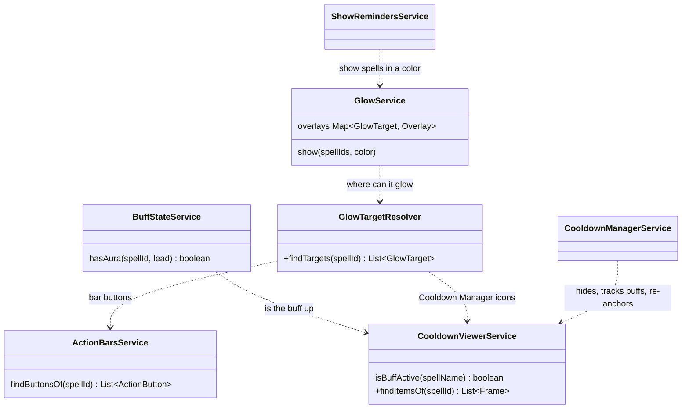

# Glow targets: glows on the Cooldown Manager

A plan, not code yet. It builds on the Cooldown Manager work of `49b3c48` (hidden buffs read from Blizzard's Cooldown Manager, refs #30).

## The idea in one minute

The Cooldown Manager is a data source. Its icons know whether a buff is up, even in a fight, when the game hides the player's auras. Glowing Bars already uses that to decide
that a reminder is due, and it lights the action bar button.

This plan keeps that and adds a second place to glow: the icons of the Cooldown Manager itself. Both places are called **glow targets**, and each has a setting of its own, so the
glow can be on the bar, on the Cooldown Manager, or on both.

|                        | Today                                      | After this plan                                |
| ---------------------- | ------------------------------------------ | ---------------------------------------------- |
| Where the state comes from | Auras, memory, the Cooldown Manager icons  | The same                                       |
| Where the glow can be  | The action bar buttons                     | The action bar buttons, the Cooldown Manager icons |
| Who finds the targets  | `GlowService`, asking `ActionBarsService`  | `GlowTargetResolver`, asked by `GlowService`   |

## How it flows

Signal, decision, draw:

1. **Signal.** `CooldownViewerService.isBuffActive()` reads the icon that tracks a buff. `BuffStateService` puts that together with the auras and the memory.
2. **Decision.** The reminders decide which spells need a glow. `ShowRemindersService` hands each type's spells and color to `GlowService`.
3. **Draw.** `GlowService` asks the new `GlowTargetResolver` where those spells can be glowed, and draws one overlay on each target.

The only change in the flow is the last step. Before, `GlowService` called `ActionBarsService.findButtonsOf()` itself.

## Classes

An arrow reads "asks". `+` marks what is new.

`GlowTarget` is a small shape in a `*.interface.ts` file: `{ frame, kind }`, where `kind` is `"bar"` or `"viewer"`.

## The pieces

**`CooldownViewerService.findItemsOf(spellId)`.** The icons of the viewers that track the spell, found the way `isBuffActive()` finds them: through `itemFramePool.EnumerateActive()`, and the
spell of each by its `cooldownID`.

**`GlowTargetResolver`.** Puts the two kinds of targets together for a spell, each only if its setting is on. It is the one place that knows what a target is, so `GlowService` does not.

**`GlowService`.** Its overlays are kept by target instead of by `ActionButton`. A bar target is drawn as today: the overlay is a child of the button. A viewer target is drawn like the
"beside" glows of the gamepad buttons, which exist already: an own frame on `UIParent`, anchored to the icon.

**`CooldownManagerService`.** Gets one more job: when the viewers lay their icons out again, the glows are asked to follow.

**Settings.** `shouldGlowCooldownManager`, off by default, next to `shouldShowCooldownManager`. The bars keep the settings they have.

## What has to be handled

- **Hidden viewer.** When the Cooldown Manager is kept out of sight, its alpha is 0. A glow on such an icon would float over nothing, so viewer targets are found only while the
  Cooldown Manager is shown.
- **Pooled icons.** The viewers reuse their icon frames and give them another `cooldownID` when the layout changes. The targets are resolved again on a layout change (`EDIT_MODE_LAYOUTS_UPDATED`, a new
  specialization) and a glow whose icon now stands for another spell is put out.
- **Buff bars.** The icons of `BuffBarCooldownViewer` are wide strips, and the flipbook glow would stretch on them. They get the clean (drawn border) styles only.
- **Missing buffs.** A reminder for a missing buff is due when the buff is down, and Tracked Buffs may not show an icon for an inactive buff. Then there is nothing to anchor to. Cooldown icons are
  always shown, so they are the first use. See the open questions.
- **Another addon runs the windows.** With EllesmereUI's Cooldown Manager the windows are left to it, as the hiding already is.

## Build order

Each step is a commit that builds and passes `pnpm test` on its own.

- [ ] `CooldownViewerService.findItemsOf()`, with a spec in `cooldown-manager.spec.ts`
- [ ] `GlowTarget` and `GlowTargetResolver`, with the bars as the only target; nothing changes for the player
- [ ] `GlowService` keeps its overlays by target, and `GlowService` asks the resolver instead of `ActionBarsService`
- [ ] Viewer targets: the own frame, the anchoring, following a new layout
- [ ] The setting, its row in the options, and the texts
- [ ] The test-kit world gets viewer icons, and specs for the viewer glow
- [ ] `README.md`, `docs/glowing-bars-description.md` and `docs/forever-quirks.md` (the pooled icons)

## Open questions

These need the game to answer.

1. Does Tracked Buffs keep a frame for a buff that is down, and where? This decides if the missing-buff glow can be on the Cooldown Manager at all.
2. Are the width and height of an icon readable in a fight? `GlowService` already keeps the last readable size, so it may only need a test.
3. Which viewers glow by default: Essential and Utility, or all four?
4. Is a glow that follows a moved icon smooth enough, or does it need to be anchored to the icon instead of placed at its position?

## Not in this plan

- Any change to the reminders, the colors or the glow styles. They are the same on both targets.
- Showing a Cooldown Manager of our own for missing buffs. That is a bigger feature, closer to the message windows, and is decided after question 1 has an answer.
